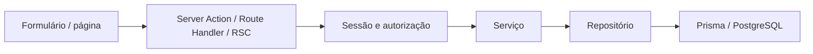

# Arquitetura

## Decisões

Monólito modular full-stack em `apps/web`: React Server Components, Server Actions e Route Handlers no mesmo Next.js. Não há API separada, serviços distribuídos ou infraestrutura de mensageria. Os pacotes são source-first, privados e consumidos pelo workspace; Next transpila os fontes TypeScript. Turborepo coordena geração, desenvolvimento, build e verificações.

- `@blab/database`: schema/migration, cliente lazy Prisma, Argon2id e bootstrap transacional. Prisma 7 usa gerador `prisma-client`, configuração em `prisma.config.ts` e adaptador PostgreSQL `PrismaPg`; não mistura configuração de versões anteriores.
- `@blab/ui`: Button genérico sem tema próprio. Componentes da aplicação permanecem em `apps/web`; não há migração visual indiscriminada.
- `@blab/types`: roles e permissões sem código de banco, seguros para consumidores de interface.
- `@blab/config`: base TypeScript estrita.

A interface v0 foi recebida na branch `feat/frontend-crm-ui` e reside em `apps/web`. Sidebar, header, temas claro/escuro, componentes e páginas usam os fontes recebidos. Não houve redesign durante a revisão da integração. O controle de acesso é real. Os fixtures de demonstração foram removidos; `lib/data.ts` retorna coleções vazias até a implementação dos módulos comerciais, sem simular consultas ao banco ou métricas. Os indicadores sem dados usam travessão, sem percentuais de crescimento fictícios. Cada página privada e o metadata de empresas validam `requireOrganization` antes de ler dados, além do guard do layout. Configurações recebe identidade e organização reais do servidor; edição permanece indisponível até existir persistência.

## Fluxo de execução

Repositórios fazem queries concretas; serviços validam credenciais e vínculos. Não há repository base, service base, container de injeção ou API interna desnecessária. Componentes nunca importam Prisma. Módulos de servidor possuem `server-only`; a exceção é o pacote database, usado também pelos scripts Node. Imports de database são proibidos por lint em componentes, páginas e features. As Actions importam serviços/autenticação e validam entrada com Zod.

## Autenticação

Auth.js Credentials delega a `authenticateCredentials`. E-mail é normalizado; a senha mantém espaços e tem tamanho limitado. O serviço consulta o repositório e verifica Argon2id (64 MiB, três iterações, paralelismo um). Conta inexistente também executa verificação de um hash aleatório para reduzir diferenças de custo. As respostas inválidas não distinguem existência de conta. O hash nunca sai do serviço de autenticação.

Credentials usa sessão JWT cifrada e cookies do Auth.js, com duração de oito horas. Não são necessários modelos Account/Session de OAuth ou adaptador de banco Auth.js para este fluxo. O token transporta o ID do usuário. O servidor reconsulta a identidade antes de permitir acesso privado; não aceita identidade enviada pelo formulário. POSTs de login e logout passam pelo fluxo CSRF do Auth.js/Server Actions. Redirect de login é fixo em `/dashboard` (a rota `/` também redireciona para `/dashboard`) e de logout em `/login`, evitando destinos controlados pelo cliente.

`requireUser` redireciona visitantes para login. O layout protege a navegação; cada página, Action e Handler privado deve também chamar `requireOrganization` ou guard adequado, pois layouts não substituem autorização de operações. `getAuthenticatedUser` e contexto usam cache React apenas por renderização/requisição, sem cache persistente entre usuários. A rota pública de sessão do Auth.js contém somente identidade pública e expiração.

A configuração de autenticação é lazy para builds sem segredos. O uso de autenticação valida AUTH_SECRET e a URL opcional; conexão ao banco valida DATABASE_URL PostgreSQL. O Prisma Client é reutilizado em módulos e no global de desenvolvimento, com pool limitado e timeout. Nenhuma configuração sensível é exposta por variáveis públicas.

## Organizações e permissões

User e Organization possuem relação N:N via OrganizationMember. Constraint única `(userId, organizationId)` impede duplicidade; índice em organizationId atende acesso por organização; foreign keys eliminam vínculos órfãos. E-mail e slug são únicos.

A organização ativa é o primeiro vínculo por criação/ID. `resolveOrganization` sempre filtra por usuário e, quando fornecido, pelo ID solicitado. O ID enviado pelo cliente não concede acesso. Vínculos e roles são resolvidos no banco, nunca de claims mutáveis do cliente. A ausência de vínculo bloqueia o conteúdo e permite logout. Não há seletor de organização nesta fase.

| Role | organization:read | organization:manage |
| --- | --- | --- |
| OWNER | Sim | Sim |
| ADMIN | Sim | Sim |
| MEMBER | Sim | Não |

A permissão manage é estrutural; não existe endpoint de gerenciamento nesta fase. Novas permissões devem ter regras explícitas, testes e autorização no servidor.

## Evolução para módulos comerciais

Adicionar funcionalidades em `features/<modulo>` e seus casos de uso em `server/services`, com queries em `server/repositories`. Cada entidade comercial futura deve ter organizationId e queries devem receber contexto validado por `requireOrganization`. Operações por ID devem filtrar simultaneamente ID e organização; não buscar globalmente para depois autorizar. Criar migration nova e testar isolamento entre duas organizações, inclusive leitura e escrita por ID.

Dados demonstrativos devem ficar em arquivos separados identificados e nunca no bootstrap ou no banco real. Integrações, leads, contatos, oportunidades e CRUD comercial permanecem fora do escopo.

## Operação e testes

Migration de produção é etapa explícita anterior à release. Bootstrap é manual, sem senhas fixas, idempotente e não redefine contas. Testes unitários não conectam ao banco. A integração constrói cluster PostgreSQL temporário e testa migrations, constraints, bootstrap e autenticação HTTP usando o build real de produção. Não utiliza credenciais de `.env`.

A implantação precisa configurar rate limiting no proxy/firewall, TLS, segredos distintos por ambiente e acesso PostgreSQL adequado. JWTs não possuem revogação por alteração de senha nesta fase. Nenhum recurso externo é presumido como provisionado.

Referências consultadas: [Auth.js Credentials](https://authjs.dev/getting-started/authentication/credentials), [configuração Prisma 7](https://www.prisma.io/docs/orm/v7/reference/prisma-config-reference), [conexões Prisma](https://www.prisma.io/docs/orm/v7/prisma-client/setup-and-configuration/databases-connections).
